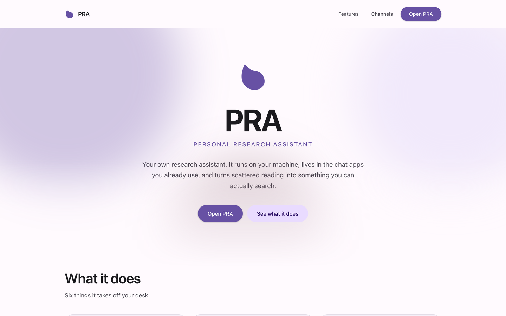

# PRA — personal research assistant



PRA is a personal research assistant for digital-humanities and
information-retrieval work. It runs on your own machine, answers in the chat
apps you already use, and keeps what you read searchable.

It is a fork of **[nanobot](https://github.com/HKUDS/nanobot)**, an open-source
agent framework. The assistant core — providers, channels, tools, sessions,
memory, the WebSocket gateway, the OpenAI-compatible API — is upstream's and
tracks it. What this fork adds is in [The research layer](#the-research-layer)
and [The interface](#the-interface).

## What it does

**Lives where you already talk.** Seventeen channel integrations ship in the
box: Telegram, Discord, Slack, Feishu, WeChat, WeCom, DingTalk, QQ, Matrix,
WhatsApp, MS Teams, Mattermost, MoChat, email, Signal, NapCat, and the
WebSocket channel that backs the browser workbench itself. No new app to open.

**Reads your library.** Point it at an Obsidian vault and it indexes the notes
you already have, in place, without moving a file. See
[the knowledge index](#the-knowledge-index).

**Keeps a map of the field.** A registry of research domains, the venues you
would publish in, and how you rank them — editable from the browser. See
[the registry](#the-domains-and-venue-registry).

**Draws what you have.** The knowledge page renders the index as a graph of
disciplines, themes and papers.

**Works while you sleep.** Scheduled jobs and automations keep collecting, and
have it waiting when you come back.

**Any model you like.** Anthropic, OpenAI-compatible, OpenAI Responses, Azure,
Bedrock, GitHub Copilot, or a local endpoint — switchable from Settings.

## The research layer

Four things upstream does not have. The first three are pages in the WebUI; the
fourth is a tool the agent gets.

### The knowledge index

`nanobot/webui/vault_index.py` reads an Obsidian vault and serves a single
JSON index at `GET /api/webui/knowledge`. It expects this layout:

```
<vault>/
└── AI Workspace/资讯检索/
    ├── 10-Papers/     *.md      one card per paper
    ├── 20-Reviews/    slr-*.md  one file per literature review
    └── 30-Weekly/     *.md      weekly digests, newest first
```

The vault root is `OBSIDIAN_VAULT`. Everything below it — the subdirectory and
all three directory names — is a constant at the top of `vault_index.py`. Only
the root is configurable, so pointing this at a vault that is not laid out this
way means editing those constants. It is a reader for one pipeline's output,
not a general Obsidian browser.

A paper card is Markdown with YAML frontmatter. `type` must be `paper` or be
absent; `source_id` (or `arxiv_id`), `title`, `year` and `venue` are read from
the frontmatter, and the body carries `## 摘要（原文）` and `## 一句话提要`
sections. Theme headings inside a review are matched as
`### Theme 1: <name>` — the number is optional.

The index is cached and rebuilt only when the vault's file fingerprint changes.
Cards that fail to parse are counted and reported rather than dropped silently,
so a page that shows fewer papers than you expect can tell you why.

The knowledge page presents the index along **four dimensions** — by theme, by
discipline, by time, and by question. The fourth one is the odd one: it scans
your own past WebUI sessions for conversations that actually called the
literature pipeline, and lists them against the library as it stood that day.
It matches on the tool *call*, not on anything the tool returned, so the
agent's own memory-consolidation sessions do not show up as research you did.

> [!IMPORTANT]
> **This repository contains the reader, not the pipeline.** The skills that
> *produce* those cards — fetching from arXiv and OpenAlex, summarising, writing
> the frontmatter — are workspace skills, and they are not in this repository.
> Out of the box the knowledge page reads whatever cards you already have. With
> no vault, it is empty, and that is the correct behaviour rather than a bug.

### The domains and venue registry

`nanobot/webui/domains_api.py` manages a registry of research domains. Each
domain lists venues with a tier, and each venue can be enabled or disabled —
so the set of places worth reading or submitting to is something you edit, not
something compiled into the code.

The registry is a JSON file the agent owns:

```
~/.nanobot/workspace/registry/domains.json
```

It is **not** committed and **not** shipped — a fresh install has no registry
until you or the agent creates one. The page lives under Settings → Domains,
and every edit on it is a real write to that file through
`/api/webui/domains/*`.

Each venue row keeps three separate things, and the distinction matters: what
the **source** says its tier is (`base_tier`), what **you** decided
(`overrides`), and the **materialised** list everything downstream reads. A
rebuild re-derives the list from the source and then re-applies your overrides
on top, so your decisions survive a refresh of the underlying data.

To be clear about what that buys you:

- A **tier** change to a generated venue is durable — it is replayed.
- Changes to a generated venue's **name, type, area or ISSN** are not; only
  rows you added by hand keep those.
- Deleting a **generated** domain is not durable either. It comes back on the
  next rebuild, and the code and the page both say so.

> [!NOTE]
> The program that rebuilds the registry is **not in this repository** — it is
> a workspace skill (`venue-registry/scripts/build_registry.py`), as is the
> CCF rankings dataset it can build from. This repository serves and edits the
> registry; producing one is the workspace's job.

### The graph

The knowledge page has a graph view: `discipline`, `theme` and `paper` nodes,
laid out with cytoscape's fCoSE. Edges connect a discipline to its themes, a
theme to its papers, and a discipline straight to any paper no theme claimed —
so nothing floats unattached. Node size grows with the square root of how much
the node holds. It is a pure function of the same index the list view uses,
which means there is no second source of truth to drift.

The graph is **disciplines, themes and papers only**. It does not extract
methods or authors from your notes, and it does not read wikilinks.

cytoscape is a ~500 kB dependency, so it is code-split into its own
`graph-vendor` chunk that the app shell never downloads. A build that
accidentally pulls it into the entry chunk fails rather than silently costing
every user half a megabyte.

### Remembering something on purpose

`nanobot/agent/tools/remember.py` gives the agent a tool for writing a note to
long-term memory mid-conversation, instead of waiting for the automatic
consolidation pass. The note is tagged — `skip`, `correction`, `permanent`,
`durable` or `ephemeral` — because the consolidation pass routes on those tags.
It is offered only in the main conversation, never to a subagent.

## The interface

The WebUI was rebuilt on Material Design 3: one token layer, a purple seed
scheme, a ten-step radius ladder, elevation shadows, and a type scale — all in
`webui/src/globals.css`, which is the only stylesheet in the app.

Two things worth knowing:

- The landing page at `/home` is a self-contained HTML file with its own copy
  of the tokens. It deliberately does not import the app's stylesheet: it is
  the page that has to work when nothing else does. The copy is a duplication
  and says so in the file.
- The app is at `/`. Routing is hash-based. `/home` is the only separate page.

There are 10 UI locales (`webui/src/i18n/locales/`). The landing page carries 3
of them — English, Simplified Chinese and Traditional Chinese. That is not an
oversight: its strings are prose rather than labels, and inventing marketing
copy in seven languages nobody here can proofread is worse than falling back to
English.

## Status

This is a personal research project, developed in the open. It is not a
product, there are no releases, and it is not on PyPI.

Forked from nanobot **v0.3.5**. The last upstream commit before the fork's own
work is `4420ad58`.

Being honest about the edges:

- The knowledge index is built against one particular vault layout, described
  above. It is not generalised, and it will not guess at yours.
- The pipeline that produces paper cards is not in this repository (see the
  note above). What is here reads cards; it does not make them.
- `OBSIDIAN_VAULT` defaults to the path on the author's own machine. If you are
  not the author, **you must set it**.
- The registry ships empty by design. There is no bundled ranking dataset, and
  the program that builds one is a workspace skill, not repo code.
- The `confirmed` flag on a domain records that you read the list. It gates
  nothing.
- The interface is fully localised, but the research layer's vocabulary is not.
  The headings it looks for inside your notes — `## 摘要（原文）`,
  `## 一句话提要`, `### Theme 1:` — are Chinese strings, because that is the
  vault it was written against. Pointing it at notes in another language means
  editing the constants in `vault_index.py`.

Planned and **not** implemented: more literature sources (bioRxiv, Europe PMC,
Semantic Scholar, Crossref), browser-driven scraping for sites without an API,
packaging the literature pipeline as an MCP server, and a canvas-style research
map. Vector retrieval is explicitly out of scope — retrieval here is over the
index, not over embeddings.

## Requirements

- **Python 3.11 or newer.**
- **Node.js with npm, or Bun.** Required, not optional — see below.
- A model provider: an API key for a hosted provider, or a local endpoint.

Git is needed to clone. Nothing else.

## Install

The WebUI ships as source, not as a prebuilt bundle (`nanobot/web/dist` is
gitignored), so a checkout has to build it. `nanobot webui` does that
automatically on first run and whenever the frontend source is newer than the
build — which is why Node or Bun is a hard requirement and not a
contributor-only concern.

```bash
git clone https://github.com/ColinWong13/nanobot_base_agent_DH.git
cd nanobot_base_agent_DH

python -m venv .venv
source .venv/bin/activate          # Windows: .venv\Scripts\Activate.ps1
python -m pip install -e .

nanobot webui
```

That builds the frontend, starts the gateway, and opens the browser workbench
at **http://127.0.0.1:8765**.

Configure a provider and model in **Settings → Models**, then send `Hello!`
before configuring anything else. The WebUI handles the first run; you do not
need to edit JSON to get one reply.

Using `uv` instead of `python -m venv` works the same way:

```bash
uv venv && uv pip install -e .
```

> [!WARNING]
> **Do not install this fork from PyPI, and do not use upstream's one-line
> installer.** Both install the package `nanobot-ai`, and that name belongs to
> upstream nanobot. `pip install nanobot-ai` and `uv tool install nanobot-ai`
> will give you upstream, without any of the research layer. Install from your
> clone.

If PyPI is slow where you are, a mirror helps a great deal:

```bash
python -m pip install -e . -i https://pypi.tuna.tsinghua.edu.cn/simple
```

## Run

```bash
nanobot webui      # gateway + browser workbench, builds the frontend if stale
nanobot            # terminal agent
nanobot status     # what is configured, what is running
nanobot gateway    # gateway only, no browser
```

The gateway serves the WebUI and the HTTP API on **8765**. The OpenAI-compatible
API (`/v1/chat/completions`, `/v1/models`) is available from `nanobot serve`.

## Tests

```bash
pytest                            # from the repo root; covers Python and channel tests
cd webui && bun run test          # frontend, vitest run (npm run test works too)
```

Two things to know before you read the results:

- The test for the registry rebuilder **skips itself** when the workspace skill
  it loads is absent — which it is on any fresh clone. Skipped is not the same
  as passed.
- A session-scoped guard fails the run if any test touches the live
  `~/.nanobot/workspace/registry/domains.json`. Your real registry is never
  written to by the test suite.

## Configuration

Everything lives under `~/.nanobot/`:

| Path | What it is |
|---|---|
| `~/.nanobot/config.json` | providers, models, channels, settings |
| `~/.nanobot/workspace/` | the agent's working directory |
| `~/.nanobot/workspace/registry/domains.json` | the domains and venue registry |
| `~/.nanobot/workspace/skills/` | workspace skills — not under version control |

Point the knowledge index at your vault:

```bash
export OBSIDIAN_VAULT="/path/to/your/vault"
```

Set it in the gateway's environment, not just your shell — the index reads it
per request.

## Why "nanobot" still appears in places

The product is PRA. The *identifiers* are still nanobot, deliberately, because
renaming them breaks things rather than rebranding them:

- the Python package and import paths (`nanobot.*`),
- the distribution name (`nanobot-ai`),
- the config directory (`~/.nanobot/`),
- the CLI command (`nanobot`) and its banner,
- localStorage keys in the browser (`nanobot-webui.theme`, `nanobot.locale`),
- the `X-Nanobot-Auth` request header, and the service worker's cache prefixes.

Renaming the storage keys alone would silently reset every existing user's
theme, language and sidebar layout. Renaming the auth header would break the
handshake between the WebUI and its own gateway. The split is: **user-visible
text says PRA; anything that is a key, a path or a protocol stays nanobot.**

So if you see "nanobot" in this repository, it is either an identifier on that
list or documentation inherited from upstream.

## Upstream, attribution and license

PRA is a fork of [HKUDS/nanobot](https://github.com/HKUDS/nanobot). The
overwhelming majority of this codebase is the upstream project and its
contributors' work; this fork adds a research layer and an interface on top.

The upstream README is preserved at
[`docs/upstream-nanobot.md`](docs/upstream-nanobot.md), and upstream's own
documentation is intact under [`docs/`](docs/) — it describes the architecture,
channels, providers and configuration accurately, because those parts are
unchanged.

Licensed under the MIT License. Copyright (c) 2025-present Xubin Ren and the
nanobot contributors; see [LICENSE](LICENSE).
